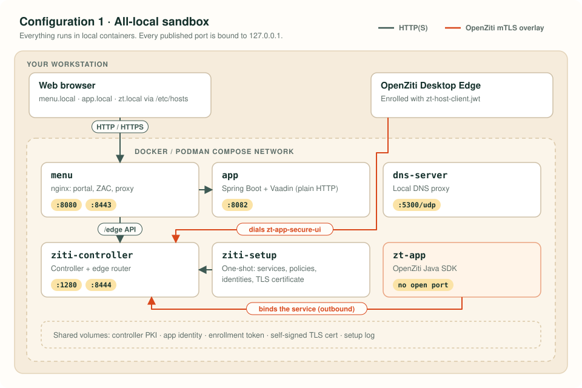
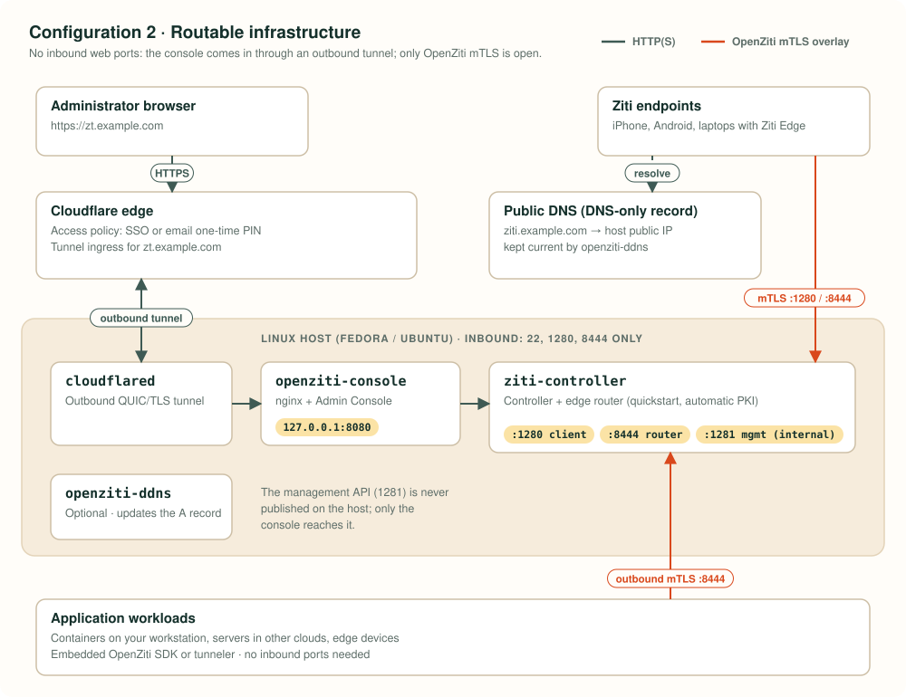

<picture>
  <source media="(prefers-color-scheme: dark)" srcset="assets/logo/baked-pasta-lockup-on-dark.svg">
  
</picture>

# Baked Pasta

Everything ziti needs, layered and baked: zero-trust architecture and demo environments built on [OpenZiti](https://openziti.io).

> [!NOTE]
> Both configurations run OpenZiti's `quickstart` container image, which bundles a single controller and edge router with an automatically generated PKI. This project is intended for demos, evaluation and small self-hosted use. It is not a highly available production deployment.

Note: This is an independent community project, not affiliated with the OpenZiti project. 

This repository provides two distinct deployment configurations designed for exploring, developing, and demonstrating Zero-Trust architectures with OpenZiti:

- **Configuration 1: All-Local Containerized Sandbox** — Run everything (OpenZiti Controller, Edge Router, Admin Console, and demo applications) on a single workstation via local containers.
- **Configuration 2: Routable OpenZiti Infrastructure + Local/Remote Application Workloads** — Stand up a dedicated, globally routable OpenZiti control plane protected by Cloudflare Access and Tunnel (zero inbound open ports), and connect containerized applications and clients running locally or across external networks (e.g., iPhones, remote clouds, distributed edge nodes).

---

## 🧭 Architectural Comparison & Choosing a Configuration

| Capability | Configuration 1: All-Local Sandbox | Configuration 2: Routable Infrastructure + Local Apps |
| :--- | :--- | :--- |
| **Primary Audience** | Quick developer evaluation & local SDK experimentation | Realistic demos, mobile devices, multi-host & enterprise edge |
| **Control Plane Location** | Workstation Docker/Podman engine | Dedicated Linux host (Fedora / Ubuntu) |
| **Application Location** | Local containers on same Docker bridge network | Local workstation containers OR remote servers/devices |
| **Ingress & Access** | Loopback `/etc/hosts` mappings (`*.local`) | Outbound Cloudflare Tunnel (`https://zt.example.com`) |
| **Inbound Firewall Ports** | N/A (Local loopback only) | **0 WAN ports open** (100% outbound-initiated QUIC/TLS) |
| **OpenZiti Admin Console (ZAC)** | `https://zt.local:8443/zac/` | `https://zt.example.com/` (directly at root `/`) |
| **Mobile Access (iOS / Android)** | ❌ **Not Possible** (devices cannot route to local containers) | ✅ **Fully Supported** (via Ziti Mobile Edge over 5G/Wi-Fi) |
| **Multi-Host / Cloud Workers** | ❌ **Not Possible** (isolated to workstation network) | ✅ **Fully Supported** (any device on internet can enroll) |
| **Team / Peer Collaboration** | ❌ **Not Possible** (strictly local loopback) | ✅ **Fully Supported** (share tokens with remote peers) |

---

## 📱 Why Configuration 2 Unlocks Advanced Use Cases

While Configuration 1 is ideal for learning the fundamentals of OpenZiti on a single laptop, **Configuration 2 is required for scenarios that cannot run on a purely local stack**:

1. **Mobile Client Demos (iOS / Android)**:
   - A physical iPhone running Ziti Mobile Edge (on cellular 5G/LTE or external Wi-Fi) cannot resolve `*.local` hostnames or route to internal container IP addresses on your laptop.
   - With Configuration 2, your iPhone enrolls against the routable OpenZiti controller and accesses zero-trust dark applications hosted locally or in the cloud.
2. **Distributed & Multi-Cloud Services**:
   - Microservices running in AWS/GCP, branch office servers, or edge gateways can connect back to your local development containers over the OpenZiti fabric without requiring VPNs, NAT traversal configurations, or public IP addresses.
3. **Remote Collaboration & Live Demonstrations**:
   - Demonstrate dark zero-trust apps to remote clients or colleagues anywhere in the world. They can enroll their devices and interact with your containerized applications without exposing any ports on your home or office router.
4. **Hardened Web Console Access**:
   - Access the OpenZiti Admin Console (ZAC) from any browser (desktop or mobile) protected by Cloudflare Access SSO / email OTP, while the underlying server remains dark to public internet port scanners.

---

## 🛠 Configuration 1: All-Local Containerized Sandbox

Run the entire OpenZiti ecosystem—controller, router, console, and sample applications—inside a local container environment.

<picture>
  <source media="(prefers-color-scheme: dark)" srcset="assets/diagrams/sandbox-on-dark.svg">
  
</picture>

### 1. Requirements
- **Docker** with Docker Compose plugin (or **Podman** with Podman Compose).
- Add the following loopback domain entries to `/etc/hosts` (requires `sudo`):
  ```hosts
  127.0.0.1 app.local menu.local ziti-controller.local zt.local
  ```
  *(Do **not** add `zt-app.local` or `zt-app-local`; the OpenZiti Desktop client intercepts these over the overlay).*

### 2. Launch the Sandbox
From the repository root:
```bash
make sandbox-up
```
On first run this creates a git-ignored `.env` (mode `0600`) containing a random OpenZiti admin password, downloads the OpenZiti Admin Console (ZAC) release into `menu/zac/` (checked against a pinned SHA-256; see [Choosing the Admin Console](#-choosing-the-admin-console-zac-or-bpc) for BPC), then runs `docker compose up -d`. The demo app images are pulled from `ghcr.io/moscait/`; if they can't be pulled, Compose builds them from `app/` and `zt-app/` automatically. There are no default credentials; `docker compose up` fails fast if `OPENZITI_ADMIN_PASSWORD` is unset.

> [!NOTE]
> Every sandbox port is bound to `127.0.0.1`. To deliberately expose the sandbox to your LAN, add `SANDBOX_BIND_ADDR=0.0.0.0` to `.env`. If you previously ran the sandbox with the old `admin`/`admin` credentials, reset it with `docker compose down -v` so the controller is re-initialized with the new password.

### 3. Access Local Services
- **Developer Portal Dashboard**: [http://menu.local:8080](http://menu.local:8080)
- **Standard Application**: [http://app.local:8080](http://app.local:8080)
- **Admin Console**: [https://zt.local:8443/zac/](https://zt.local:8443/zac/) (user `admin`, password from `OPENZITI_ADMIN_PASSWORD` in `.env`). This is ZAC unless you [chose BPC](#-choosing-the-admin-console-zac-or-bpc).

### 4. Enroll Local Client & Access Dark App
1. Download the generated client enrollment token (`zt-host-client.jwt`) from the Developer Portal dashboard.
2. In **OpenZiti Desktop Edge**, click **Add Identity** and import the `.jwt` file.
3. Access the dark Zero-Trust application securely over the overlay at: [http://zt-app-local:8080](http://zt-app-local:8080).

### 5. Tear Down
```bash
docker compose down -v
# or using Makefile:
make sandbox-down
```

---

## 🌐 Configuration 2: Routable OpenZiti Infrastructure + Local/Remote Containers

Stand up a dedicated OpenZiti control plane on a remote Linux machine (Fedora or Ubuntu) exposed securely to the internet through Cloudflare Tunnel, while running example application containers locally on your workstation or across distributed nodes.

<picture>
  <source media="(prefers-color-scheme: dark)" srcset="assets/diagrams/routable-on-dark.svg">
  
</picture>

### 1. Deploy the OpenZiti Infrastructure

> [!TIP]
> **No server yet?** [`infrastructure/oracle-cloud/`](infrastructure/oracle-cloud/README.md) creates an Always Free Oracle Cloud host (Ubuntu or Oracle Linux) with OpenTofu. You get a reserved public IP, and a cloud firewall that allows only SSH from your IP plus `1280`/`8444`. Then point `deploy-ziti.sh --ssh` at it.

> [!IMPORTANT]
> **Cloudflare setup is required first.** Create (1) the Cloudflare Tunnel (`zt.<domain> → http://localhost:8080`) + Access policy for the Admin Console, and (2) a DNS-only (grey-cloud) `A` record (`ziti.<domain> → host public IP`) for OpenZiti mTLS traffic on TCP `1280`/`8444`, as described in the **[Cloudflare Configuration Guide](infrastructure/CLOUDFLARE.md)**. Without a token the deployer refuses to run unless you explicitly opt in to an unauthenticated TryCloudflare Quick Tunnel with `--quick`.

Deploy directly from your workstation to your remote Linux server over SSH without needing `git` or repository access on the target server. Secrets are read from environment variables (never put them on the command line, where they are visible in `ps` and shell history), and are streamed to the host over SSH stdin:

```bash
# Read secrets without echoing them or saving them to shell history:
read -rsp 'Tunnel token: ' CLOUDFLARE_TUNNEL_TOKEN; echo
read -rsp 'DNS-only API token (Zone.DNS:Edit): ' CLOUDFLARE_DNS_API_TOKEN; echo
export CLOUDFLARE_TUNNEL_TOKEN CLOUDFLARE_DNS_API_TOKEN

# Deploy (the admin password is auto-generated on the host unless OPENZITI_ADMIN_PASSWORD is set):
./deploy-ziti.sh --ssh user@192.0.2.10 --advertise-address ziti.example.com

# Or via Makefile (values are passed to the deployer as environment variables):
make ziti-ssh TARGET=user@192.0.2.10 ADVERTISE=ziti.example.com \
  TOKEN="$CLOUDFLARE_TUNNEL_TOKEN" DNS_TOKEN="$CLOUDFLARE_DNS_API_TOKEN"
```

> [!NOTE]
> SSH host keys are verified. Connect once with `ssh user@host` to trust a new host before deploying. A custom admin password (`OPENZITI_ADMIN_PASSWORD`) must be 12–128 characters with no quotes, backslashes, `$`, backticks or whitespace.

The installer:
- Configures host container runtime (Docker CE on Ubuntu or Podman on Fedora).
- Hardens the OS firewall (`ufw` or `firewalld`): **zero inbound web ports** (`8080` is bound to `127.0.0.1`), allowing only SSH and the OpenZiti mTLS ports (`1280/tcp` and `8444/tcp`).
- Splits the OpenZiti Controller listeners so public port `1280` serves **only** client enrollment/authentication and the router control plane, while the management API (`1281`) is isolated to the internal container network (reachable solely through the Cloudflare Access-protected console).
- Starts the `openziti-ddns` container (when `--dns-token` is provided) to automatically create and update the DNS-only `A` record for `--advertise-address` whenever your home WAN IP changes.
- Connects the outbound Cloudflare Tunnel (token passed via environment, not process arguments).
- Persists credentials to `/opt/openziti/.ziti-credentials` (`mode 0600`) and secrets to `.env` (`mode 0600`); the rendered `docker-compose.yaml` contains no secrets. The password is **not** printed — view it with `sudo cat /opt/openziti/.ziti-credentials`.
- Rate-limits console login attempts and adds security headers in the console's nginx.

### 2. Access the OpenZiti Admin Console (ZAC)
1. Open your browser and navigate to your public domain (e.g., `https://zt.example.com`).
2. Pass your Cloudflare Access authentication (email OTP, Google Workspace, GitHub, or Okta SSO).
3. The admin console (ZAC, or [BPC](#-choosing-the-admin-console-zac-or-bpc) if you chose it) displays directly at root. Log in with the credentials from `/opt/openziti/.ziti-credentials` on the host.

### 3. Connect Example Applications to the Routable Infrastructure
Once the infrastructure is active, you can run containerized applications locally on your workstation that connect directly to your routable OpenZiti control plane:
- Use ZAC to create a service and generate an enrollment identity (`.jwt`).
- Provide the identity to your local containerized application.
- The local application connects outbound to the infrastructure overlay network, making it instantly reachable to any enrolled device (including your iPhone over cellular data).

### 4. Tear Down
Tear down the infrastructure from your workstation over SSH:

```bash
# Full teardown: removes containers, network, PKI volume and /opt/openziti
./deploy-ziti.sh --ssh user@192.0.2.10 --teardown

# Keep PKI, enrolled identities and credentials (containers only) for a later redeploy:
./deploy-ziti.sh --ssh user@192.0.2.10 --teardown --keep-data

# Or via Makefile (add KEEP_DATA=1 and/or YES=1 to skip the confirmation prompt):
make ziti-teardown TARGET=user@192.0.2.10
```

> [!WARNING]
> A full teardown deletes the controller PKI. Every enrolled identity (laptops, iPhones, application containers) stops working and must be re-enrolled after a redeploy.

Then clean up the rest:
- **Oracle Cloud host:** if you created it with [`infrastructure/oracle-cloud/`](infrastructure/oracle-cloud/README.md#-tear-down), run `cd infrastructure/oracle-cloud && tofu destroy` (or `make oci-destroy`). That deletes the instance, boot volume, reserved IP and VCN. Destroying the host also removes OpenZiti, so the `--teardown` step above is optional in that case.
- **Cloudflare:** if managed by OpenTofu, run `cd infrastructure/opentofu && tofu destroy`; otherwise delete the tunnel, DNS record and Access application in the Cloudflare Zero Trust dashboard.
- **Local application containers:** stop the workloads that were bound to the infrastructure.
- **Not reverted:** the container runtime (Docker/Podman) and firewall hardening (`ufw`/`firewalld`) remain on the host.

> [!NOTE]
> `make ziti-down` only stops a stack started on the *current* machine from `infrastructure/docker-compose.cloudflare.yaml`; it does not touch remote infrastructure deployed over SSH.

For comprehensive infrastructure instructions, Ansible details, and OpenTofu IaC templates, see the [Infrastructure README](infrastructure/README.md).

---

## 🎛 Choosing the Admin Console: ZAC or BPC

Both configurations can serve either of two admin consoles, at the same URLs:

| | **ZAC** (default) | **BPC** |
| :--- | :--- | :--- |
| **What** | [OpenZiti Admin Console](https://github.com/openziti/ziti-console) | Baked Pasta Console: a ZAC-compatible console built around the Access Canvas, guided service wizards and staged changes you review before applying |
| **Build** | Sandbox: stock 4.8.0. Routable infrastructure: 4.8.1 with the Access Canvas view (see `NOTICE`) | [Release 0.2.2](https://github.com/moscait/baked-pasta-console/releases/tag/v0.2.2), served in both configurations |
| **Source** | Pinned release, downloaded and SHA-256-verified | Pinned release, downloaded and SHA-256-verified |

Select BPC with `CONSOLE=bpc` (make) or `--console bpc` (scripts):

```bash
make sandbox-up CONSOLE=bpc
make ziti-ssh TARGET=user@192.0.2.10 ADVERTISE=ziti.example.com CONSOLE=bpc
./deploy-ziti.sh --ssh user@192.0.2.10 -a ziti.example.com --console bpc
```

To move to a newer BPC release, run `make bpc-pin` (or `make bpc-pin VERSION=v0.1.2`). It checks the release against GitHub's checksum and updates the pin. Commit that, then deploy as usual; the changed pin replaces the installed console.

To try unreleased BPC work, add `BPC_DIR=../baked-pasta-console` (builds that checkout with `npm`) or `BPC_ZIP=<archive>` (an archive made with `npm run package:zac`).

Setting `BAKED_PASTA_CONSOLE=bpc` in your environment makes BPC the default. Switching consoles replaces the installed one, and so does a newer pinned release. Otherwise, running again with the same console keeps it (add `FORCE=1` or `--force` to reinstall, or pass `BPC_DIR`/`BPC_ZIP` to rebuild). To swap the console on a running deployment without touching the controller, use `make console-update TARGET=user@host CONSOLE=bpc ...`.

---

## 📂 Repository Directory Structure

```
├── infrastructure/               # Configuration 2: Routable Zero-Trust Infrastructure
│   ├── README.md                 # Detailed infrastructure architecture & operations guide
│   ├── CLOUDFLARE.md             # Required Cloudflare Tunnel, DNS & Access configuration
│   ├── ansible/                  # Ansible cross-distro automation (Fedora & Ubuntu)
│   │   ├── ansible.cfg           # SSH host-key checking on; auto_silent python discovery
│   │   ├── inventory.ini         # Target inventory definitions
│   │   ├── playbook.yml          # Main orchestration playbook
│   │   ├── teardown.yml          # Infrastructure teardown playbook (--teardown)
│   │   ├── tasks/                # Distribution & container setup tasks
│   │   └── vars/                 # Infrastructure parameters and ports
│   ├── console/                  # Admin Console build, fetched on deploy (git-ignored)
│   ├── deploy.sh                 # Infrastructure deploy script wrapper
│   ├── docker-compose.cloudflare.yaml # Infrastructure compose configuration
│   ├── nginx/                    # Nginx reverse proxy configuration for root ZAC
│   ├── opentofu/                 # OpenTofu/Terraform IaC for Cloudflare DNS, Tunnels & SSO
│   ├── oracle-cloud/             # OpenTofu/Terraform for an Oracle Cloud (Always Free) host
│   └── templates/                # Jinja2 compose template (secrets come from .env at runtime)
├── app/                          # Standard Spring Boot demo application (HTTP)
├── zt-app/                       # Secure demo application embedded with OpenZiti Java SDK
├── menu/                         # Configuration 1: Local sandbox developer portal & UI (zac/ fetched)
├── assets/logo/                  # Logo, wordmark and GitHub social preview (built by scripts/logo/)
├── assets/diagrams/              # README architecture diagrams, light & dark (built by scripts/diagrams/)
├── scripts/                      # Console fetch & build, logo and diagram generators, console demo
├── docs/DECISIONS.md             # Why things are built this way, and when to revisit each decision
├── docker-compose.yaml           # Configuration 1: Local sandbox compose definition
├── deploy-ziti.sh                # Workstation CLI for streaming infrastructure deployments over SSH
├── Makefile                      # Convenient shortcuts for building, running, and deploying
├── LICENSE                       # Apache License 2.0
└── NOTICE                        # Attribution, including the Admin Console
```

---

## 🔐 Security

- Please report vulnerabilities privately as described in [SECURITY.md](SECURITY.md), not in a public issue.
- Never commit `.env`, `config/`, `*.tfstate`, `terraform.tfvars` or `.ziti-credentials`; they are git-ignored because they contain credentials and private keys.
- Container images (compose files and Dockerfile base images), GitHub Actions and the downloaded Admin Console are pinned by digest or checksum; Dependabot proposes updates.

---

## 🤝 Contributing

Contributions are welcome. See [CONTRIBUTING.md](CONTRIBUTING.md) for setup, the checks CI runs, and conventions, and the [Code of Conduct](CODE_OF_CONDUCT.md).

The reasoning behind the design (and when each choice should be revisited) is in the [decision log](docs/DECISIONS.md).

---

## 📄 License

Licensed under the [Apache License 2.0](LICENSE). It downloads and uses third-party software, including the OpenZiti Admin Console; see [NOTICE](NOTICE).
