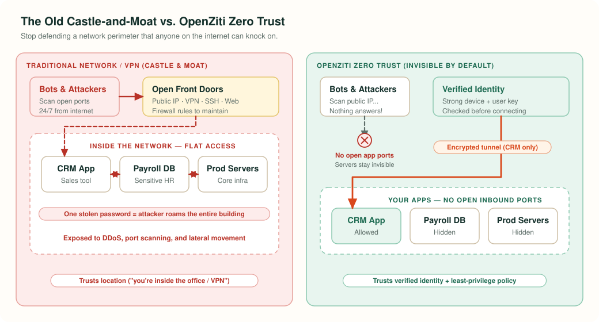
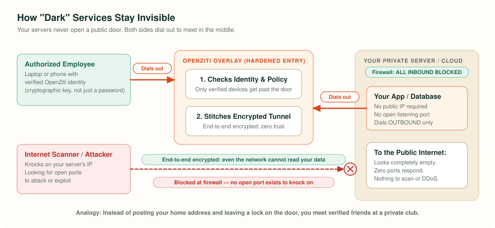
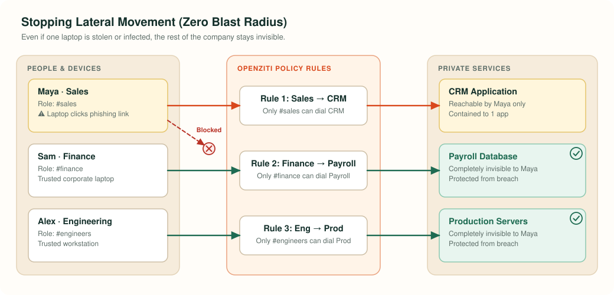
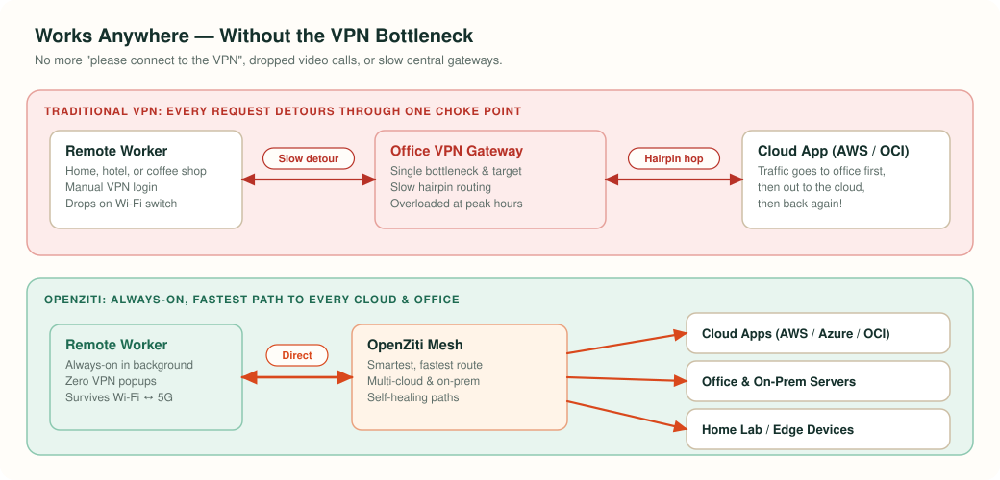
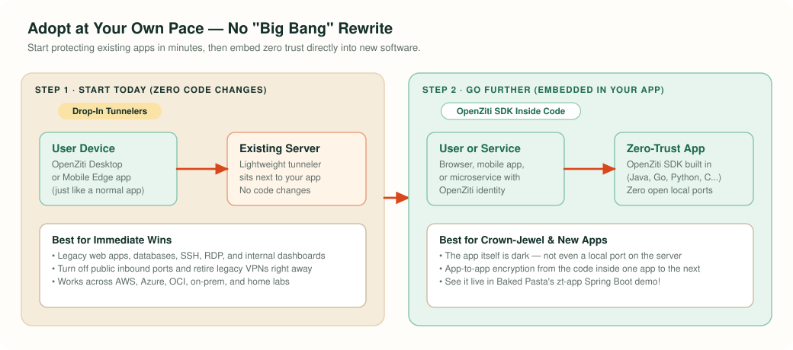

# Why Use OpenZiti?

*A clear, approachable guide to Zero Trust networking — no cybersecurity degree required.*

> [!TIP]
> **Presenting this to a team?** Open the interactive **[Browser Slide Show](why-openziti-slides.html)** directly in any web browser (supports keyboard arrows, fullscreen `F`, slide grid `G`, speaker notes `N`, and light/dark mode `T`).

---

## The 30-Second Version

Most companies protect their software like a **medieval castle**: they build a wall around the network, leave a few front doors open (websites, VPNs, remote logins), and trust everyone who makes it inside.

The problem? **Anyone on the internet can walk up to those doors 24 hours a day and try to break in** — and if one employee's password or laptop is compromised, the intruder can wander freely inside the castle unless you build and maintain extra layers of internal walls.

**OpenZiti** flips the model completely:

1. **No open doors on your apps or servers** — Your apps and databases become **"dark"** (invisible to scanners and attackers), because they only make *outbound* connections to a hardened OpenZiti rendezvous point.
2. **Prove who you are *before* connecting** — Every person and device is verified cryptographically before a single byte reaches your app.
3. **Built-in least privilege** — Like a hotel keycard that opens *your* room, never a master key to the whole building — without bolting on extra internal firewall systems.
4. **Works anywhere, with no VPN headaches** — Always-on, fast, and seamless across home Wi-Fi, coffee shops, offices, and clouds.

---

## 1. The Old Castle vs. OpenZiti Zero Trust

Traditional networks were designed decades ago when everyone sat in the same office building and all software lived in a basement server room. Today, people work from everywhere and apps live across multiple clouds.

Putting a VPN in front of a traditional network only moves the front door — it still leaves a public doorway for bots to hammer, and once someone is inside the VPN, they get broad network access unless you bolt on and maintain extra micro-segmentation layers (VLANs, internal firewalls, or separate policy tools).

<picture>
  <source media="(prefers-color-scheme: dark)" srcset="../assets/diagrams/why-castle-vs-zero-trust-on-dark.svg">
  
</picture>

**In plain terms:** Instead of trusting *where* someone is sitting ("you're in the office" or "you're on the VPN"), OpenZiti trusts **verified identity and explicit permission** for every single application.

---

## 2. Invisible ("Dark") Services: You Can't Attack What You Can't Find

Every minute of every day, automated bots scan the entire public internet looking for open doors (open network ports) and known software flaws. If your server has a public door, bots *will* find it within minutes.

OpenZiti eliminates inbound doors altogether. Your server's firewall blocks **100% of incoming traffic**. Instead, your server makes an **outbound** connection to the OpenZiti network, and authorized users also dial **outbound**. OpenZiti checks identity and permissions first, then stitches a private, end-to-end encrypted tunnel between them.

<picture>
  <source media="(prefers-color-scheme: dark)" srcset="../assets/diagrams/why-dark-services-on-dark.svg">
  
</picture>

- **No public IP required** for your internal apps or databases.
- **Immune to port scanning and direct DDoS** against your private servers — there is literally nothing listening for attackers to hit.
- **No firewall-rule spaghetti** — IT no longer has to punch temporary holes in firewalls every time a remote worker or partner needs access.

> [!NOTE]
> **Wait — doesn't *something* still need an open port?**
> Yes! Good catch. The **OpenZiti overlay itself** (the meeting point in the middle) has a small, hardened entry point so your devices and servers have somewhere to dial out to — guarded by strict cryptographic identity checks before any traffic is forwarded. What stays **100% dark with zero open inbound ports** are your actual **applications, databases, and private servers**. Think of it like a private club: the club has one heavily guarded front door, so you never have to publish your own home address or leave doors open at your house.

---

## 3. Stopping Lateral Movement: Containing the Blast Radius

Most headline-making data breaches do not happen in one step. An attacker phishes a single employee in Sales, lands on their laptop, and then quietly explores the company network until they find Payroll, Customer Databases, or Production Servers. That roaming is called **lateral movement**.

Can you add **micro-segmentation** on top of a traditional VPN to limit lateral movement? **Yes** — using extra VLANs, internal firewalls, or separate segmentation tools. The catch is that it becomes **one more complex system to buy, configure, and keep in sync** every time an app moves or a team changes.

With OpenZiti, micro-segmentation isn't an add-on — it is built into how connections work from day one. Each person and device only receives private, encrypted paths to the exact apps their role allows. Everything else doesn't just say "Access Denied" — **it does not exist on their network at all**.

<picture>
  <source media="(prefers-color-scheme: dark)" srcset="../assets/diagrams/why-least-privilege-on-dark.svg">
  
</picture>

- **One compromised laptop does not equal a company-wide breach.**
- **Contractors and partners** can be given temporary access to *one* specific tool without ever touching your internal network.
- **Instant offboarding:** Revoking an identity cuts off access everywhere in seconds.

---

## 4. Works Anywhere — Without the VPN Bottleneck

Ask any remote employee what they hate most about corporate IT, and **"the VPN"** is usually at the top of the list. Traditional VPNs force all traffic to detour through a single central office gateway — even when the employee is at home and the app is in the cloud.

OpenZiti replaces that central bottleneck with an intelligent, always-on overlay mesh.

<picture>
  <source media="(prefers-color-scheme: dark)" srcset="../assets/diagrams/why-everywhere-no-vpn-on-dark.svg">
  
</picture>

- **Zero "connect to VPN" popups:** It runs quietly in the background. Users just open their apps normally.
- **Faster performance:** Traffic takes the shortest path straight to AWS, Azure, Oracle Cloud, your office, or an edge device.
- **Survives network changes:** Switching from home Wi-Fi to mobile 5G doesn't kick you out of your work.

---

## 5. Adopt at Your Own Pace — No "Big Bang" Rewrite

A common worry is: *"This sounds great, but do we have to rewrite all our software?"*

**No.** OpenZiti meets you where you are with two complementary approaches:

<picture>
  <source media="(prefers-color-scheme: dark)" srcset="../assets/diagrams/why-adoption-paths-on-dark.svg">
  
</picture>

1. **Step 1 — Start Today (Zero Code Changes):** Drop a lightweight OpenZiti Tunneler next to your existing apps, databases, or servers, and install the OpenZiti Edge app on laptops/phones. You can close public inbound ports and retire legacy VPNs immediately.
2. **Step 2 — Go Further (Embedded in Your App):** For crown-jewel or newly built software, developers can embed the OpenZiti SDK directly inside the application code. The app doesn't even open a local network port — end-to-end encryption runs directly from code to code.

---

## At a Glance: Traditional VPN vs. OpenZiti

| Question | Traditional VPN / Firewall | OpenZiti |
| :--- | :--- | :--- |
| **Can strangers on the internet find your servers?** | Yes — open public ports are scanned 24/7 | **No** — your app servers are outbound-only ("dark"); only the hardened overlay accepts verified connections |
| **What happens if one laptop is compromised?** | By default, the attacker can roam (blocking this requires bolting on & maintaining separate micro-segmentation tools) | **Contained by default** — least-privilege micro-segmentation is built in; other apps don't exist to that device |
| **What is the day-to-day employee experience?** | Manual VPN logins, slow connections, frequent drops | **Invisible** — always-on, fast, works from anywhere |
| **Can it span multiple clouds and offices?** | Complex site-to-site VPNs and overlapping IP headaches | **Effortless** — one unified private overlay across all clouds |
| **Do we have to rewrite existing apps?** | No | **No** — start with drop-in tunnelers, embed SDKs later |
| **Is it locked to one vendor?** | Often proprietary hardware or per-seat appliances | **100% Open Source** (Apache 2.0), self-hostable anywhere |

---

## What It Means for Every Role

- **For Business Leaders & Executives:** Dramatically shrinks the risk of ransomware and data breaches, simplifies compliance audits (least-privilege access by default), and avoids vendor lock-in because OpenZiti is open source.
- **For Everyday Employees:** No more wrestling with flaky VPN clients or waiting on IT tickets just to work from a hotel, home office, or phone.
- **For IT & Operations:** Eliminates fragile firewall-rule spreadsheets, public IP exposure, and complex multi-cloud VPN peering.
- **For Software Developers:** Lets apps communicate securely across any network without worrying about IP addresses, NAT, firewalls, or TLS certificate plumbing.

---

## Try It Live in 5 Minutes

This repository (**Baked Pasta**) includes a self-contained local sandbox that lets you experience the difference firsthand — comparing a traditional exposed web app side-by-side with an invisible, zero-port OpenZiti app (`zt-app`):

```bash
make sandbox-up
```

See the [README](../README.md) for the quickstart, or launch the **[Browser Slide Show](why-openziti-slides.html)** to walk your team through these concepts in presentation mode.
