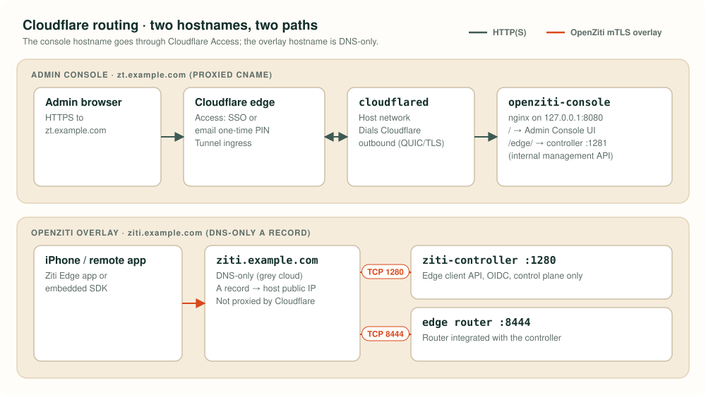

# ☁️ Cloudflare Configuration for the OpenZiti Infrastructure (Configuration 2)

This guide explains the Cloudflare setup required **before** running `./deploy-ziti.sh` for Configuration 2.

Because Cloudflare Tunnel proxies **HTTP(S)** while OpenZiti clients (iPhones, laptops, remote app containers) require **end-to-end mutual TLS**, Configuration 2 uses **two DNS hostnames** in your Cloudflare zone:

1. **Admin Console (`zt.<domain>`) — Proxied (orange cloud) via Cloudflare Tunnel + Access.**
   Serves the OpenZiti Admin Console (ZAC) and its `/edge/` management API proxy. Zero inbound web ports are opened on the host (`8080` is bound to `127.0.0.1`), and the controller's management API (`1281`) is isolated to the internal Docker network so it **cannot** be reached without passing Cloudflare Access first.
2. **OpenZiti Overlay (`ziti.<domain>`) — DNS-only (grey cloud) `A` record → host public IP (automatically kept updated by `openziti-ddns`).**
   Carries encrypted mTLS traffic directly to the host on **TCP `1280`** (client enrollment, authentication, and router control plane — *no management API*) and **TCP `8444`** (edge router data plane). When you provide a Zone.DNS:Edit-only token via `CLOUDFLARE_DNS_API_TOKEN`, the host starts the `openziti-ddns` sidecar (`favonia/cloudflare-ddns`), which automatically creates the `ziti.<domain>` `A` record (`PROXIED=false`, `TTL=120`) and updates it whenever your home ISP changes your WAN IP.

You can configure Cloudflare either **manually in the dashboard** ([Option A](#option-a--cloudflare-dashboard-manual)) or **declaratively with OpenTofu** ([Option B](#option-b--opentofu-infrastructure-as-code)).

---

## 🧭 Architecture & Traffic Split

<picture>
  <source media="(prefers-color-scheme: dark)" srcset="../assets/diagrams/cloudflare-routing-on-dark.svg">
  
</picture>

| Hostname / Port | Exposure | Purpose |
|---|---|---|
| `zt.<domain>` | Cloudflare Tunnel + Access (proxied) | ZAC web UI + `/edge/` management proxy |
| `127.0.0.1:8080` on host | Loopback only | `openziti-console` (nginx) — origin for `cloudflared` |
| `ziti-controller.local:1281` | Internal container network only | Controller `edge-management` & `fabric` APIs (unreachable from WAN/LAN; returns `404` on port `1280`) |
| `ziti.<domain>:1280` | Public TCP (`ufw` / `firewalld` allowed) | Controller `edge-client`, `edge-oidc` (enrollment/auth) & router control plane |
| `ziti.<domain>:8444` | Public TCP (`ufw` / `firewalld` allowed) | Edge Router mTLS data plane for enrolled clients and application SDKs |
| `openziti-ddns` container | Outbound HTTPS to Cloudflare API | Automatically creates & updates the DNS-only `ziti.<domain>` `A` record every 5m when your home WAN IP changes |

---

## ✅ Prerequisites

1. **A Cloudflare account** — the Free plan is sufficient.
2. **A domain whose DNS is managed by Cloudflare** — the zone must be *Active* (nameservers pointed at Cloudflare).
3. **A Cloudflare Zero Trust organization** — open **Zero Trust** from the dashboard sidebar the first time, choose a team name, and select the Free plan (up to 50 users). Required for Tunnels and Access.
4. **Reachability for OpenZiti mTLS ports (`1280` and `8444`)**:
   - **Cloud VM / VPS:** allow inbound **TCP `1280`** and **TCP `8444`** in the cloud security group (do **not** open `80`, `443`, `8080`, or `1281`).
   - **Home / office server behind NAT:** port-forward **TCP `1280`** and **TCP `8444`** on your WAN router to the host's LAN IP.
   - The Ansible installer automatically opens `22/tcp`, `1280/tcp`, and `8444/tcp` in `ufw` (Ubuntu) or `firewalld` (Fedora) and denies all other inbound ports.

---

## Option A — Cloudflare Dashboard (Manual)

### A1. Create the tunnel and copy its token

1. Go to **Zero Trust → Networks → Tunnels** and click **Create a tunnel**.
2. Choose **Cloudflared** as the connector type and name it (e.g. `openziti-tunnel`).
3. On the *Install and run connectors* screen, pick **Docker** and copy the command shown. It contains the token — a long string beginning with `eyJh…`.
   - **Do not run that command on the host.** The deployer starts `cloudflared` for you inside the `openziti-tunnel` container.
   - Provide the token via the `CLOUDFLARE_TUNNEL_TOKEN` environment variable (or the interactive prompt). You can paste either the bare token or the whole `docker run … --token eyJh…` line; `deploy-ziti.sh` extracts the `eyJh…` portion automatically.
   - To check the token before deploying, run `make ziti-check-token` (or `./deploy-ziti.sh --check-token`). It decodes the token locally, without contacting Cloudflare, and prints the tunnel ID; compare it with the tunnel's ID in the dashboard. Deploys run the same check automatically.
4. Click **Next**.

#### Finding the token again for an existing tunnel

Cloudflare only shows the token on the connector install screen, not on the tunnel's **Routes** (or *Public Hostname*) tab. To get it again later, for a redeploy:

1. Open the tunnel. Depending on your dashboard version, tunnels are under **Zero Trust → Networks → Tunnels** or under **Networking → Tunnels** in the main dashboard.
2. On the tunnel's **Overview** tab (or via **Configure** / **Edit** in the older dashboard), use the option to add a connector. It may be labelled **Add a replica**, **Install connector** or **Run connector**, or be in the page's **⋯** menu.
3. Pick **Docker** and copy the command; the token is the `eyJh…` string after `--token`. Opening this screen does not create or run anything.

If the tunnel is already deployed, the host also has the token. This prints it to your terminal, so make sure nobody can see your screen:

```bash
ssh <user>@<host> "sudo grep '^CLOUDFLARE_TUNNEL_TOKEN=' /opt/openziti/.env | cut -d= -f2-"
```

The DNS API token from A3 can't be viewed again in Cloudflare after it's created. It's in the same file as `CLOUDFLARE_DNS_API_TOKEN`; otherwise create a new one.

### A2. Add the public hostname for the Admin Console

On the tunnel's **Routes** tab (**Public Hostname** in the older dashboard), add a published application route:

| Field | Value |
|---|---|
| Subdomain | `zt` (or your choice) |
| Domain | your Cloudflare zone, e.g. `example.com` |
| Path | *(leave empty — ZAC is served at root and must also reach `/edge/`)* |
| Service Type | **HTTP** |
| URL | **`localhost:8080`** |

Save the tunnel. Cloudflare automatically creates the proxied `CNAME zt → <tunnel-id>.cfargotunnel.com` DNS record.

> [!WARNING]
> Use `localhost:8080` (or `127.0.0.1:8080`) — **not** `console:8080` or `openziti-console:8080`. The `cloudflared` container uses host networking, so Docker service names do not resolve and you will get **502 Bad Gateway**. Also use **HTTP**, not HTTPS: nginx listens on plain HTTP on loopback; Cloudflare terminates TLS at the edge.

### A3. Set up the DNS-only record for OpenZiti mTLS (`ziti.<domain>`)

**Recommended (Dynamic Home WAN IP — Automatic DDNS):**
1. Go to **My Profile → API Tokens → Create Token → Edit zone DNS template**.
2. Under **Zone Resources**, select **Include → Specific zone → `<your-domain>`**, then click **Continue to summary → Create Token** and copy the token.
3. Export that token as `CLOUDFLARE_DNS_API_TOKEN` when deploying in Step A5. Keep it scoped to **Zone.DNS:Edit on this one zone only**: it is stored on the host (in a `0600` `.env`), so it must never be a broader account token. The `openziti-ddns` container on the host will automatically detect your current home WAN IP, create the grey-cloud `A` record for `ziti.<domain>` (`TTL=120s`), and update it every 5 minutes if your ISP changes your IP.

**Alternative (Static Public IP — Manual DNS record):**
1. In the main Cloudflare dashboard for your domain, go to **DNS → Records → Add record**.
2. Configure:
   - **Type:** `A` (or `AAAA` for IPv6)
   - **Name:** `ziti` (produces `ziti.example.com`)
   - **IPv4 address:** your host's static public WAN IP
   - **Proxy status:** **DNS only (grey cloud)** — *critical: if orange-clouded, Cloudflare's HTTP proxy intercepts TLS and breaks OpenZiti enrollment and router connections on ports `1280`/`8444`.*
3. Save the record.

### A4. Protect the console with Cloudflare Access (required for a secure deployment)

Without this step, **anyone on the internet can reach the ZAC login page and the OpenZiti management API** (proxied under `/edge/`) at `https://zt.example.com`, protected only by the admin password.

1. Go to **Zero Trust → Access → Applications → Add an application → Self-hosted**.
2. Configure:
   - **Application name:** `OpenZiti Console Access`
   - **Session duration:** `24h`
   - **Public hostname / Application domain:** `zt.example.com` — leave the path empty so the policy covers both `/` and `/edge/`.
3. Add a policy:
   - **Policy name:** `Allow Authorized Emails`
   - **Action:** `Allow`
   - **Include → Emails:** the addresses allowed to administer the infrastructure (or *Emails ending in* `@yourcompany.com`).
4. **Login methods:** One-time PIN works out of the box. Optionally add Google, GitHub, Okta, etc. under **Zero Trust → Settings → Authentication**.
5. Save the application.

### A5. Deploy with the tunnel token, advertise address, and DNS token

```bash
read -rsp 'Tunnel token: ' CLOUDFLARE_TUNNEL_TOKEN; echo
read -rsp 'DNS-only API token: ' CLOUDFLARE_DNS_API_TOKEN; echo
export CLOUDFLARE_TUNNEL_TOKEN CLOUDFLARE_DNS_API_TOKEN
./deploy-ziti.sh --ssh user@192.0.2.10 --advertise-address ziti.example.com
```

Continue with [Verify](#-verify-the-setup).

---

## Option B — OpenTofu (Infrastructure-as-Code)

The [`opentofu/`](opentofu/) module creates:
- The Cloudflare Tunnel and its ingress rule (`zt.<domain> → http://127.0.0.1:8080`)
- The proxied `CNAME` record for `zt.<domain>`
- The DNS-only (grey-cloud) `A` record for `ziti.<domain>` pointing to `server_public_ip`
- The Cloudflare Access application and email policy for `zt.<domain>` (when `enable_access_sso = true`)

### B1. Create a Cloudflare API token

**My Profile → API Tokens → Create Token → Custom token** with these permissions:

| Scope | Permission | Access |
|---|---|---|
| Account | Cloudflare Tunnel | Edit |
| Account | Access: Apps and Policies | Edit *(when `enable_access_sso = true`)* |
| Zone | DNS | Edit |
| Zone | Zone | Read |

Restrict **Account Resources** to your account and **Zone Resources** to the target zone.

### B2. Gather IDs and public IP

- **Account ID** and **Zone ID**: open your domain in the Cloudflare dashboard → *Overview* page → right-hand **API** panel.
- **Host public IP**: run `curl -4 ifconfig.me` on the host (or on the network whose router forwards `1280`/`8444`).

### B3. Configure and apply

```bash
cd infrastructure/opentofu
cp terraform.tfvars.example terraform.tfvars
```

Edit `terraform.tfvars`:

| Variable | Description | Default |
|---|---|---|
| `cloudflare_api_token` | Token from B1 (sensitive) | — |
| `cloudflare_account_id` | Account ID from B2 | — |
| `cloudflare_zone_id` | Zone ID from B2 | — |
| `domain_name` | Zone name, e.g. `example.com` | — |
| `tunnel_name` | Tunnel display name | `openziti-tunnel` |
| `console_subdomain` | Proxied subdomain for ZAC | `zt` |
| `ziti_subdomain` | DNS-only subdomain for OpenZiti mTLS (`1280`/`8444`) | `ziti` |
| `server_public_ip` | Optional static IPv4 for `ziti_subdomain` (leave `""` for dynamic home IP with `openziti-ddns`) | `""` |
| `enable_access_sso` | Create the Access application + policy | `true` (disable only if you protect the hostname another way) |
| `allowed_user_emails` | Emails allowed by the Access policy (**required** while `enable_access_sso = true`; `tofu apply` fails if empty) | `[]` |

```bash
tofu init
tofu apply
tofu output console_url              # https://zt.example.com
tofu output ziti_advertise_address   # ziti.example.com
```

> [!CAUTION]
> `terraform.tfvars` contains your API token and `terraform.tfstate` contains the tunnel token. Both are already listed in the repo's `.gitignore` — keep it that way, and store state securely if you move it to a remote backend.

### B4. Deploy with the generated outputs (including automatic DDNS)

> [!IMPORTANT]
> Do **not** reuse the broad OpenTofu API token from B1 for DDNS. It can manage tunnels, Access and DNS for your account, and the DDNS token is stored on the host. Create a separate **Edit zone DNS** token scoped to this single zone (see A3).

```bash
export CLOUDFLARE_TUNNEL_TOKEN="$(tofu -chdir=infrastructure/opentofu output -raw tunnel_token)"
read -rsp 'DNS-only API token (Zone.DNS:Edit): ' CLOUDFLARE_DNS_API_TOKEN; echo; export CLOUDFLARE_DNS_API_TOKEN
./deploy-ziti.sh --ssh user@192.0.2.10 \
  --advertise-address "$(tofu -chdir=infrastructure/opentofu output -raw ziti_advertise_address)"
```

(`tofu output -raw deploy_command` prints these steps with your hostname filled in. It contains no secrets.)

---

## 🔎 Verify the Setup

1. **Tunnel health** — *Zero Trust → Networks → Tunnels*: status should be **Healthy**. On the host:
   ```bash
   docker logs openziti-tunnel     # Ubuntu (podman logs openziti-tunnel on Fedora)
   ```
   Look for `Registered tunnel connection`.
2. **Access gate on the console** — from a machine not logged in to Access:
   ```bash
   curl -sI https://zt.example.com | head -5
   ```
   Expect a `302` redirect to `https://<team>.cloudflareaccess.com/…`.
3. **Public client API vs. blocked management API on port `1280`** — from any external machine:
   ```bash
   # Client API is reachable for enrollment and SDK sessions (200 OK):
   curl -ks -o /dev/null -w "%{http_code}\n" https://ziti.example.com:1280/edge/client/v1/version

   # Management API is NOT bound on public port 1280 (404 Not Found):
   curl -ks -o /dev/null -w "%{http_code}\n" https://ziti.example.com:1280/edge/management/v1/version
   ```
4. **Console login & mobile enrollment** — open `https://zt.example.com` and pass Cloudflare Access. On first visit ZAC asks for a controller: enter any **name** (for example `baked-pasta`) and, as the **URL**, the console's own address `https://zt.example.com` with no port. The management API is served through the console's `/edge/` proxy; it is not available on `ziti.example.com:1280`. Then log in to ZAC with the credentials in `/opt/openziti/.ziti-credentials`. Create an identity and download its `.jwt` (or scan its QR code from Ziti Mobile Edge on an iPhone over cellular); the token's issuer will be `https://ziti.example.com:1280` and the edge router will advertise `ziti.example.com:8444`.

> [!NOTE]
> **Changing `--advertise-address` after first deploy:** the advertised hostname is baked into the controller's PKI, `ctrl.yaml`, and the enrolled edge router certificate on first boot. To switch from `ziti-controller.local` to a public hostname (or between domains), run a full teardown first (`./deploy-ziti.sh --ssh user@host --teardown`) and then deploy with the new `--advertise-address`.

---

## ⚡ Quick Tunnel Mode (No Account)

`./deploy-ziti.sh --quick` (or choosing Quick Tunnel and typing `yes` at the interactive prompt) runs `cloudflared tunnel --url http://127.0.0.1:8080`, yielding a random `https://<words>.trycloudflare.com` URL for ZAC. Deploying without a token is otherwise refused.

- ⚠️ **No Cloudflare Access** — the ZAC login page and the management API behind it are reachable by anyone who learns the TryCloudflare URL. Login attempts are rate-limited by nginx, but the admin password is the only barrier.
- The URL **changes every time** `openziti-tunnel` restarts.
- If you still want remote clients to enroll while using Quick Tunnel for ZAC, pass `--advertise-address <public-ip-or-dns>` so ports `1280`/`8444` advertise a routable address.

---

## 🛠 Troubleshooting

| Symptom | Likely cause | Fix |
|---|---|---|
| **Error 1033** in browser | Tunnel has no running connector | Check `docker logs openziti-tunnel`; confirm the token is correct and outbound 7844/443 is allowed |
| **502 Bad Gateway** on `zt.<domain>` | Origin unreachable from `cloudflared` | Public hostname service must be `http://localhost:8080`; confirm `openziti-console` is running (`docker ps`) |
| ZAC loads, but login fails | `/edge/` blocked or controller still bootstrapping | Ensure the hostname route and Access app have **no path** restriction; on first boot, wait ~30s for the listener split to complete (`docker logs ziti-controller.local`) |
| iPhone / remote client fails to enroll or times out on `:1280` / `:8444` | `ziti.<domain>` is orange-clouded, or ports `1280`/`8444` aren't forwarded/open, or the stack was deployed without `--advertise-address` | Set `ziti.<domain>` to **DNS only (grey cloud)**; verify `nc -vz ziti.example.com 1280` and `8444` from an external network; check the `.jwt` payload (`cut -d. -f2 id.jwt \| base64 -d`) shows `"iss":"https://ziti.example.com:1280"` |
| Access login loop | Third-party cookies blocked or mismatched app domain | Make sure the Access application domain exactly matches the public hostname |

---

## 🧹 Removing the Cloudflare Configuration

Tearing down the infrastructure does **not** remove Cloudflare resources. After running `./deploy-ziti.sh --ssh user@host --teardown` (see the [main README](../README.md#4-tear-down)):

- **OpenTofu:** `cd infrastructure/opentofu && tofu destroy`
- **Dashboard:** delete the Access application (*Access → Applications*), the tunnel (*Networks → Tunnels*), and both DNS records (`zt` CNAME and `ziti` A record under *DNS → Records*).
