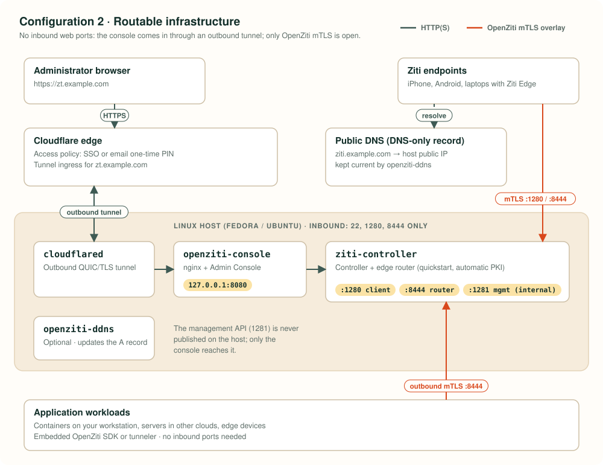

# OpenZiti Zero-Trust Infrastructure (Cloudflare-Protected)

This directory provides automated deployment for dedicated **OpenZiti Zero-Trust Infrastructure** running on **Fedora** or **Ubuntu** Linux. It packages the **OpenZiti Controller**, **Edge Router**, and the **OpenZiti Admin Console (ZAC)**, protected by **Cloudflare Tunnel (`cloudflared`)** and Cloudflare Access.

This architecture enables security professionals, enterprise developers, and infrastructure teams to stand up an instantly reachable, production-grade OpenZiti control plane without opening any inbound firewall ports or configuring public DNS records on local routers.

---

## 🏛 Architecture & Security Model

<picture>
  <source media="(prefers-color-scheme: dark)" srcset="../assets/diagrams/routable-on-dark.svg">
  
</picture>

### Why This Architecture?
- **Zero Inbound Web Ports & Isolated Management API**: Inbound ports 80, 443, and 8080 remain completely closed (`8080` is bound to `127.0.0.1`), and the controller's management API (`1281`) is isolated to the internal container network. Admin traffic enters exclusively through an outbound-initiated Cloudflare Tunnel gated by Cloudflare Access.
- **Direct mTLS Overlay for Remote Clients**: A separate DNS-only (`ziti.<domain>`) hostname points to the host's public IP on TCP `1280` (client enrollment & router control plane only — `/edge/management` returns `404`) and TCP `8444` (edge router data plane), allowing iPhones and remote workloads to enroll and connect with end-to-end mutual TLS.
- **Root Admin Console**: The OpenZiti Admin Console (ZAC) is served directly at root (`https://zt.example.com/`), with no demo menus or intermediate landing pages.
- **Enterprise-Grade Identity Protection**: Place Cloudflare Access in front of your console to enforce email OTP, Google Workspace, GitHub, or Okta SSO before anyone reaches the OpenZiti login screen.
- **Automated Credential Generation**: Administrative credentials are generated with high-entropy random strings (or supplied via environment variables), stored only in `0600` files on the host, and never printed to the terminal or Ansible logs.
- **Full Edge Router Included**: The stack bundles an active OpenZiti Edge Router and provisions default edge router policies so client identities (laptops, mobile devices, servers) can connect seamlessly.

---

## 💻 Supported Operating Systems

- **Fedora Linux** (Versions 38, 39, 40, 41+) using `dnf`, `firewalld`, SELinux container policies, and Podman/Docker.
- **Ubuntu Linux** (Versions 20.04 LTS, 22.04 LTS, 24.04 LTS) using `apt`, `ufw`, and Docker Engine.
- **Oracle Linux 9** (and other Enterprise Linux: CentOS Stream, Rocky, AlmaLinux) using the same `dnf`, `firewalld` and Podman path as Fedora, with `podman-compose` from EPEL.

Need a host? **[`oracle-cloud/`](oracle-cloud/README.md)** creates an Always Free Oracle Cloud instance (Ubuntu 24.04 or Oracle Linux 9) with OpenTofu. It has a reserved public IP, and a security list that allows only 22 (your IP), 1280 and 8444.

---

## ⚡ 1-Command Automated Deployment

No prior package installation or manual repository cloning is required on the target machine.

> [!IMPORTANT]
> Before deploying with `--token`, complete the **[Cloudflare Configuration Guide](CLOUDFLARE.md)** (tunnel + Access for `zt.<domain>`, and a DNS-only `A` record for `ziti.<domain>`).

### Mode 1: Stream Over SSH from your Workstation (RECOMMENDED)
Deploy directly to your remote Linux server from your development machine:

```bash
# Secrets come from environment variables (not CLI args, which leak via `ps` and shell history):
read -rsp 'Tunnel token: ' CLOUDFLARE_TUNNEL_TOKEN; echo
read -rsp 'DNS-only API token (Zone.DNS:Edit, optional): ' CLOUDFLARE_DNS_API_TOKEN; echo
export CLOUDFLARE_TUNNEL_TOKEN CLOUDFLARE_DNS_API_TOKEN
# Optional custom admin password (otherwise auto-generated on the host):
# read -rsp 'Admin password: ' OPENZITI_ADMIN_PASSWORD; echo; export OPENZITI_ADMIN_PASSWORD

./deploy-ziti.sh --ssh user@192.0.2.10 --advertise-address ziti.example.com

# Or via Makefile (values are forwarded as environment variables):
make ziti-ssh TARGET=user@192.0.2.10 ADVERTISE=ziti.example.com \
  TOKEN="$CLOUDFLARE_TUNNEL_TOKEN" DNS_TOKEN="$CLOUDFLARE_DNS_API_TOKEN"
```

**How this works without cloning on the target:**
Your workstation creates a private (`0700`) temporary directory on the remote host, streams `deploy-ziti.sh` and the `infrastructure/` bundle into it over SSH, and sends the secrets over SSH stdin into a `0600` file that is sourced and deleted before the installer starts. Secrets never appear on any command line. The directory is removed on exit.

> [!NOTE]
> SSH host keys are verified (`host_key_checking = True`). Connect once with `ssh user@host` to trust a new host. Custom admin passwords must be 12–128 characters with no quotes, backslashes, `$`, backticks or whitespace (port `1280` is internet-facing, so short passwords are rejected).

### Mode 2: Run Locally on the Host
If you are already logged in to the target machine:

```bash
read -rsp 'Tunnel token: ' CLOUDFLARE_TUNNEL_TOKEN; echo; export CLOUDFLARE_TUNNEL_TOKEN
./deploy-ziti.sh --advertise-address ziti.example.com
```

### Mode 3: Zero-Account Ephemeral Quick Tunnel (TryCloudflare) — explicit opt-in
If you don't have a Cloudflare account or tunnel token yet:

```bash
./deploy-ziti.sh --quick
```
The deployer will create an ephemeral TryCloudflare tunnel and print the generated public HTTPS URL.

> [!WARNING]
> Quick Tunnel mode has **no Cloudflare Access**. Anyone who learns the random URL reaches the console login and the OpenZiti management API behind it, protected only by the admin password. Use it for short-lived evaluation only. Without a token and without `--quick`, the deployer refuses to run.

---

## 🔐 Credentials & Secrets Management

When the deployment finishes, the script prints a summary. The password itself is **not** printed:

```text
======================================================
✔ OPENZITI INFRASTRUCTURE DEPLOYED SUCCESSFULLY!
======================================================
OpenZiti Admin Console (ZAC): http://127.0.0.1:8080/ (loopback + Cloudflare Tunnel)
OpenZiti Client & Ctrl Plane: https://ziti.example.com:1280/ (public mTLS)
OpenZiti Edge Router:         tls://ziti.example.com:8444 (public mTLS)
OpenZiti Management API:      internal-only (1281, reachable solely via ZAC)
Administrator Username:       admin
Administrator Password:       auto-generated (not printed)
Credentials file (0600):      /opt/openziti/.ziti-credentials
                              view on the host with: sudo cat /opt/openziti/.ziti-credentials
Protected Console Ingress:    Cloudflare Tunnel (port 8080 loopback-only) - enable Cloudflare Access!
======================================================
```

Credentials are saved on the host at `/opt/openziti/.ziti-credentials` (`mode 0600`). Secrets used by the containers live in `/opt/openziti/.env` (`mode 0600`); the rendered `docker-compose.yaml` contains none. Note that anyone with Docker/Podman access on the host can read container environments (`docker inspect`), which is equivalent to root.

---

## 🖥 Updating or Customizing the Admin Console

`infrastructure/console/` holds the console that gets deployed. It is build output and is not committed: `deploy-ziti.sh` installs the selected console when it's missing (`scripts/fetch-console.sh infrastructure`, or `make console-fetch`). By default that is ZAC: a pinned build with the Access Canvas view (see `NOTICE`), checked against the SHA-256 recorded in the script. To deploy the Baked Pasta Console (BPC) instead, add `--console bpc` (or `CONSOLE=bpc` with `make`) and set `BPC_DIR` or `BPC_ZIP`; see [Choosing the Admin Console](../README.md#-choosing-the-admin-console-zac-or-bpc). To test a fork, a branch, or an unreleased fix, build the console from source and push only the console to a running host:

```bash
# Build from a git repo and ref (default: upstream openziti/ziti-console@main)...
./scripts/build-console.sh --repo https://github.com/<you>/ziti-console.git --ref <branch>
# ...or from a local checkout:
./scripts/build-console.sh --from-dir ../ziti-console

# Replace the console files and nginx config on the host and restart only the console container.
# No tunnel token needed; the controller, PKI, identities and credentials are untouched.
./deploy-ziti.sh --ssh user@192.0.2.10 --update-console

# Makefile equivalents:
make console-build REPO=https://github.com/<you>/ziti-console.git REF=<branch>
make console-update TARGET=user@192.0.2.10
```

The script runs the same production build as the upstream release (Node 18+ required), drops source maps, and writes `infrastructure/console/BUILD-INFO.txt` with the repo, branch and commit. To go back to the pinned build, fetch it again (replacing your custom build) and push it:

```bash
./scripts/fetch-console.sh infrastructure --force     # or: make console-fetch FORCE=1
./deploy-ziti.sh --ssh user@192.0.2.10 --update-console
```

> [!NOTE]
> **Console login and OIDC.** ZAC 4.3+ logs in through the controller's OIDC provider when the controller advertises it. That needs `/oidc/` proxied to the controller and `https://<console-host>/auth/callback` registered in the controller's `edge-oidc` redirect URIs, which this stack doesn't configure yet. Until it does, nginx hides the `OIDC_AUTH` capability so ZAC uses the classic password login. Logging in works the same way; TOTP-at-login via OIDC isn't available.
>
> The classic password login is deprecated in OpenZiti 2.x and will be removed in OpenZiti 3.0, so the OIDC setup will be needed before moving to 3.0.

---

## ⬆️ OpenZiti Versions and Upgrades

The stack runs OpenZiti **2.0.8** (pinned by digest in `ansible/vars/main.yml` and the compose files). In 2.x, `ziti edge quickstart` always runs the controller as a single-member HA (raft) cluster and keeps its config, raft data and router files in `/persistent/instance-1/` inside the PKI volume.

**Upgrading from 1.x is not possible in place.** A 1.x volume keeps `ctrl.yaml` directly in `/persistent`, which the 2.x quickstart can't use. The controller refuses to start on such a volume (rather than silently creating a second, empty network). Tear down with the default `--teardown` (which deletes the PKI volume) and deploy again. This creates a new network: all identities, services and policies must be re-created and every device re-enrolled.

**Enrollment tokens expire after 3 hours** by default. Reissuing an expired token from ZAC works on 2.x; on 1.x it produced JWTs that the controller rejected (`INVALID_ENROLLMENT_TOKEN`).

---

## 🧹 Teardown

```bash
# Full teardown over SSH (prompts for confirmation):
./deploy-ziti.sh --ssh user@192.0.2.10 --teardown

# Remove containers but preserve the PKI volume and /opt/openziti:
./deploy-ziti.sh --ssh user@192.0.2.10 --teardown --keep-data

# Non-interactive (CI/automation):
./deploy-ziti.sh --ssh user@192.0.2.10 --teardown --yes

# Locally on the host:
./deploy-ziti.sh --teardown

# Via Makefile:
make ziti-teardown TARGET=user@192.0.2.10 [KEEP_DATA=1] [YES=1]

# Or Ansible directly:
ANSIBLE_CONFIG=infrastructure/ansible/ansible.cfg ansible-playbook \
  -i infrastructure/ansible/inventory.ini \
  infrastructure/ansible/teardown.yml \
  [-e "keep_data=true"]
```

| Removed by teardown | Full | `--keep-data` |
|---|:-:|:-:|
| Containers (`ziti-controller.local`, `ziti-setup`, `openziti-console`, `openziti-tunnel`) | ✅ | ✅ |
| `openziti-network` | ✅ | ✅ |
| `openziti_ziti-pki-data` volume (PKI, identities) | ✅ | ❌ |
| `/opt/openziti` (`.env` tunnel token, `.ziti-credentials`) | ✅ | ❌ |

Not reverted: the container runtime and firewall hardening. Remove Cloudflare resources separately with `tofu destroy` (see below) or via the Cloudflare dashboard.

Host on Oracle Cloud? Delete it with `cd infrastructure/oracle-cloud && tofu destroy` (or `make oci-destroy`), which removes the instance, boot volume, reserved IP and VCN. See [oracle-cloud/README.md › Tear down](oracle-cloud/README.md#-tear-down).

---

## 🛠 Manual Ansible Execution

If you prefer using Ansible directly:

```bash
ANSIBLE_CONFIG=infrastructure/ansible/ansible.cfg ansible-playbook \
  -i infrastructure/ansible/inventory.ini \
  infrastructure/ansible/playbook.yml \
  -e "cloudflare_tunnel_token=YOUR_TOKEN"
```

---

## 📐 Declarative IaC with OpenTofu (Optional)

If you prefer managing your Cloudflare Tunnel, DNS CNAME records, and Cloudflare Access policies via Infrastructure-as-Code (see [CLOUDFLARE.md › Option B](CLOUDFLARE.md#option-b--opentofu-infrastructure-as-code) for required API token permissions):

1. Navigate to the OpenTofu directory:
   ```bash
   cd infrastructure/opentofu
   ```
2. Copy the example configuration:
   ```bash
   cp terraform.tfvars.example terraform.tfvars
   ```
3. Update `terraform.tfvars` with your Cloudflare API token, Account ID, and Zone ID.
4. Apply the configuration:
   ```bash
   tofu init
   tofu apply
   ```
5. Run the generated deployment command output by OpenTofu.
