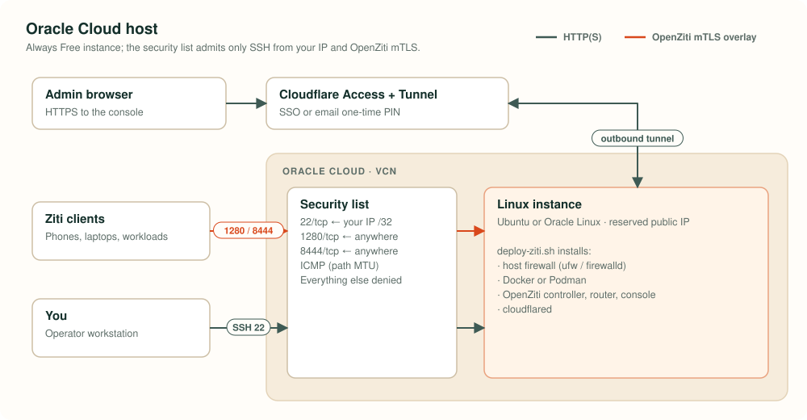

# ☁️ Oracle Cloud (OCI) Host for Baked Pasta

This OpenTofu / Terraform module creates a ready-to-deploy Linux host on **Oracle Cloud Infrastructure**. You can run the [OpenZiti infrastructure](../README.md) on it with one `deploy-ziti.sh` command. The defaults (`VM.Standard.A1.Flex` with 1 OCPU / 6 GB, Ampere ARM, and a 50 GB boot volume) fit within Oracle's **Always Free** allowance. See [Cost](#-cost-always-free).

| Created | Details |
|---|---|
| VCN + internet gateway + public subnet | `10.0.0.0/16` / `10.0.1.0/24` (configurable) |
| Security list (cloud firewall) | **22/tcp** from your IP only (auto-detected), **1280/tcp** and **8444/tcp** from anywhere. Nothing else. |
| Instance | Latest **Ubuntu 24.04** or **Oracle Linux 9** image for the shape (aarch64 or x86_64), with your SSH public key |
| Reserved public IP | Survives instance re-creation, so the `ziti.<domain>` DNS record never changes |

Ports **80, 443 and 8080 stay closed**. The Admin Console is published through Cloudflare Tunnel, an outbound connection from the host, as described in [CLOUDFLARE.md](../CLOUDFLARE.md).

<picture>
  <source media="(prefers-color-scheme: dark)" srcset="../../assets/diagrams/oracle-cloud-on-dark.svg">
  
</picture>

---

## 🐧 Choose the operating system

Set `base_os` in `terraform.tfvars`:

| `base_os` | Image | SSH user | Container engine | Host firewall |
|---|---|---|---|---|
| `ubuntu` (default) | Canonical Ubuntu `ubuntu_version` (default `24.04`) | `ubuntu` | Docker Engine | `ufw` |
| `oraclelinux` | Oracle Linux `oraclelinux_version` (default `9`) | `opc` | Podman (+ `podman-compose` from EPEL, `podman-docker`) | `firewalld`, SELinux enforcing |

Oracle Linux is RHEL-compatible and is the closest option on OCI if you'd otherwise choose CentOS or Rocky. The playbook takes the same Fedora/RedHat path for it: it enables `oracle-epel-release` to get `podman-compose`, then sets up Podman and firewalld.

The SSH user depends on the OS. Use the `ssh_user`, `ssh_command` and `baked_pasta_ssh_target` outputs rather than typing it by hand. Changing `base_os` on an existing host **replaces the instance**. The reserved IP is kept, but you have to run `deploy-ziti.sh` again.

## ✅ Prerequisites

1. **An OCI account.** Find your **tenancy OCID** (Profile menu → *Tenancy*) and your **home region**.
2. **OCI CLI** for authentication (`brew install oci-cli`, or see Oracle's install guide).
3. **OpenTofu** (`brew install opentofu`) or **Terraform** ≥ 1.6.
4. **An SSH key pair**, for example `ssh-keygen -t ed25519`. Keep the private key: OCI never stores or recovers it.
5. **Cloudflare setup** for the console and the `ziti.<domain>` record, as in [CLOUDFLARE.md](../CLOUDFLARE.md). You can do this after the host exists.

## 🔑 Authenticate (no secrets in this repo)

The module reads credentials from `~/.oci/config`. Pick one method:

```bash
# A) Browser login (default, oci_auth = "SecurityToken"). The session lasts about 1 hour.
oci session authenticate --profile-name DEFAULT --region us-ashburn-1
#    Later: oci session refresh   (or run authenticate again once it has expired)

# B) API signing key (oci_auth = "ApiKey"). Long-lived, good for automation.
oci setup config
```

## 🚀 Create the host

```bash
cd infrastructure/oracle-cloud
cp terraform.tfvars.example terraform.tfvars   # set tenancy_ocid, region, ssh_public_key_path, ziti_advertise_address, base_os
tofu init
tofu apply
```

Or from the repository root, using `make oci-init`, `make oci-apply` and `make oci-output`.

Outputs:

| Output | Use |
|---|---|
| `public_ip` | Target for the DNS-only `A` record `ziti.<domain>`, or `server_public_ip` in [`../opentofu`](../opentofu) |
| `ssh_user` | Login user for the chosen OS (`ubuntu` or `opc`) |
| `ssh_command` | SSH to the host by IP |
| `ssh_by_name` | SSH by `ziti_advertise_address` once its DNS record exists |
| `baked_pasta_ssh_target` | `--ssh` value for `deploy-ziti.sh` / `make ziti-ssh TARGET=` |
| `image` | The image the instance was created from |
| `next_steps` | DNS, host-key, and deploy commands with your values filled in |

## 🌐 Deploy OpenZiti on it

`deploy-ziti.sh` runs a plain `ssh`, so the key must be one ssh finds on its own. If your key isn't a default name like `~/.ssh/id_ed25519`, load it into the agent first, or add a `Host` entry with `IdentityFile` to `~/.ssh/config`.

```bash
# From the repository root, after the Cloudflare tunnel + DNS records exist.
# <user> is the ssh_user output: ubuntu or opc.
ssh-add ~/.ssh/id_ed25519                              # only needed for a non-default key name
ssh <user>@<public_ip> true                            # trust the host key once (Ansible verifies host keys)
read -rsp 'Tunnel token: ' CLOUDFLARE_TUNNEL_TOKEN; echo; export CLOUDFLARE_TUNNEL_TOKEN
./deploy-ziti.sh --ssh <user>@<public_ip> --advertise-address ziti.example.com
```

In zsh, `read -rsp` fails with `read: -p: no coprocess`. Use `read -rs 'CLOUDFLARE_TUNNEL_TOKEN?Tunnel token: '` instead.

Because the IP is reserved and static, you don't need the `openziti-ddns` sidecar. Use a static `A` record, or set `server_public_ip` in the Cloudflare OpenTofu module, and leave `CLOUDFLARE_DNS_API_TOKEN` unset.

The admin password is generated on the host and never printed. Read it with `ssh <user>@<public_ip> sudo cat /opt/openziti/.ziti-credentials`.

Verify from outside, using the checks in [CLOUDFLARE.md › Verify](../CLOUDFLARE.md#-verify-the-setup):

```bash
nc -vz ziti.example.com 1280 && nc -vz ziti.example.com 8444   # open
nc -vz -w 5 ziti.example.com 443                               # times out (closed)
```

On the host, check the containers with `sudo docker ps` on Ubuntu or `sudo podman ps` on Oracle Linux.

## 💲 Cost (Always Free)

With the defaults, everything this module creates is covered by Oracle's [Always Free](https://docs.oracle.com/en-us/iaas/Content/FreeTier/freetier_topic-Always_Free_Resources.htm) allowance. The allowance is per tenancy, so other instances you run count against it too.

| Resource | Module default | Always Free allowance |
|---|---|---|
| Ampere A1 compute | 1 OCPU / 6 GB | **2 OCPUs / 12 GB in total** (1,500 OCPU-hours and 9,000 GB-hours a month) |
| Boot + block storage | 50 GB | 200 GB in total, in the home region |
| VCN, internet gateway, subnet | 1 VCN | 2 VCNs; gateways and subnets cost nothing |
| Reserved public IP | 1 | Oracle doesn't charge for reserved public IPs |
| Outbound data | OpenZiti traffic | 10 TB a month |

- **Create it in your home region.** Always Free compute and storage only exist there; other regions are billed.
- **Pay As You Go accounts have no cap.** Always Free usage stays free, but anything beyond it is billed automatically. For example, `instance_ocpus = 3`, a second 2-OCPU instance, or more than 200 GB of storage all cost money. A small budget alert (*Billing → Budgets*) is a cheap safety net.
- **Free-tier accounts** (never upgraded) simply can't create resources beyond the allowance, but Oracle may reclaim Always Free instances that stay idle (under 20% CPU, network and memory) for 7 days.
- **Oracle changes these limits from time to time.** Check the linked page before sizing up.

## 🔧 Notes

- **Your IP changed?** Run `tofu apply` again. Only the SSH rule changes; the instance is untouched. To pin a range, set `ssh_source_cidr`.
- **"Out of host capacity"** is common for A1 in busy regions. Try `availability_domain_index = 1` or `2`, or retry later.
- **Host firewall on Ubuntu:** OCI's Ubuntu images ship iptables `REJECT` rules that conflict with ufw. [`cloud-init.yaml`](cloud-init.yaml) clears them on first boot, and the playbook then enables ufw (22, 1280, 8444 only).
- **Host firewall on Oracle Linux:** OCI's Oracle Linux images already run firewalld, so no cloud-init is applied. The playbook opens 1280 and 8444 and keeps SSH allowed.
- **Newer images** don't trigger replacement (`ignore_changes` on the image). To rebuild on the latest image, run `tofu apply -replace=oci_core_instance.ziti`. The reserved IP stays the same.
- **State:** `terraform.tfvars`, `*.tfstate` and `.terraform/` are git-ignored. They contain your tenancy and IP details.

## 🧹 Tear down

Destroying the host removes the OpenZiti containers along with it, so running `deploy-ziti.sh --teardown` first is optional.

```bash
# 1. (Optional) Remove the OpenZiti stack first, e.g. to keep the host:
./deploy-ziti.sh --ssh <user>@<public_ip> --teardown

# 2. Delete everything this module created: instance, boot volume, reserved IP, subnet, gateway, VCN.
#    Needs a valid OCI session (`oci session authenticate`) - it expires after about an hour.
cd infrastructure/oracle-cloud && tofu destroy        # or from the repo root: make oci-destroy
```

`tofu destroy` lists what it will delete and asks for `yes`. Afterwards, `tofu state list` should print nothing.

Then clean up outside OCI:

- **Cloudflare:** delete the tunnel, the `zt` CNAME, the `ziti` A record and the Access application, or run `tofu destroy` in [`../opentofu`](../opentofu) if you created them there. See [CLOUDFLARE.md › Removing](../CLOUDFLARE.md#-removing-the-cloudflare-configuration).
- **Your workstation:** remove the old host key with `ssh-keygen -R <public_ip>` and `ssh-keygen -R ziti.example.com`, plus any `~/.ssh/config` entry you added for the host. A new instance gets a new host key, and ssh will refuse to connect while the old one is still recorded.
- **Not deleted by this module:** anything you created by hand in OCI, such as budgets, extra volumes or Resource Manager stacks.
